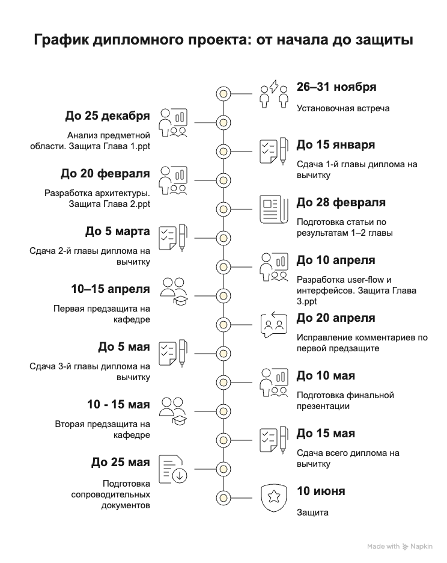

# План работ по диплому

> 📐 Этот гайд объясняет, *как* делать. Формальные требования (структура, объёмы, сроки, оформление) зависят от уровня — см. [requirements/](../requirements/README.md). При расхождении цифр правы требования.

> 📅 **Календарный график кафедры в СДО первичен.** Ниже — этапы без конкретных дат; точные даты, шаблоны и порядок сдачи публикует кафедра. Сроки и пороги — см. требования вашего уровня: [бакалавр](../requirements/bachelor-2026-27.md) / [магистр](../requirements/master.md).

*Иллюстрация рабочего ритма «презентация по главе → текст»; даты на схеме ориентировочные.*

**Материалы для отчётов по главам:**
- [Шаблон рабочей презентации](../templates/presentation/diploma-working-presentation-template.pptx)
- [Примеры отчётов по главам](../examples/presentations/README.md)

## Календарь бакалавра (кафедра ИП, 2026/27)

| Этап | Когда | Результат |
| --- | --- | --- |
| Выбор темы и руководителя, резервация в этом репозитории | начало осеннего семестра | Тема зафиксирована в общей таблице кафедры |
| Задание на ВКР | осень; сдача в зимнюю сессию | Подписанное задание: тема, цель, задачи, этапы |
| Отчёт 1 — анализ предметной области (глава 1) | осенний семестр | Рабочая презентация → текст главы 1 на вычитку |
| Приказ об утверждении тем | начало весеннего семестра | Тема закреплена официально |
| Отчёт 2 — проектирование (глава 2) | первая половина весеннего семестра | Рабочая презентация → текст главы 2 на вычитку |
| Предзащита | 11-я учебная неделя весеннего семестра, онлайн | Обязательна; 3–5 минут по текущему состоянию работы, демо кода не требуется |
| Отчёт 3 — реализация и тестирование (глава 3) | после предзащиты | Рабочая презентация → текст главы 3 на вычитку |
| Полный текст на вычитку руководителю | до сдачи в СДО, с запасом на две итерации правок | Согласованный текст |
| Сдача в СДО, нормоконтроль, антиплагиат, допуск | по графику кафедры | Комплект файлов, положительное заключение руководителя |
| Проверка комплектности | за 3 дня (кафедра) и за 2 дня (секретарь ГЭК) до защиты | Полный комплект в СДО и на бумаге |
| Защита | по графику учебного отдела | Доклад + презентация + вопросы ГЭК |

Консультации с руководителем — с частотой по требованиям кафедры (ведётся журнал посещаемости). Статья по материалам работы — **по желанию**, для допуска не требуется (см. [245-scientific-paper.md](245-scientific-paper.md)).

## Календарь магистра

| Этап | Когда | Результат |
| --- | --- | --- |
| Выбор темы и руководителя, резервация в этом репозитории | начало осеннего семестра (перечень тем утверждается за 6 месяцев до ГИА) | Заявление, закрепление темы приказом |
| Задание на ВКР и календарный график | осень, совместно с руководителем | Подписанное задание с этапами и сроками |
| Отчёт 1 — литературный обзор и постановка задачи (глава 1) | осенний семестр | Рабочая презентация → текст главы на вычитку |
| Отчёт 2 — модели/методы, архитектура (глава 2) | первая половина весеннего семестра | Рабочая презентация → текст главы на вычитку |
| **Статья по материалам работы** | к весеннему семестру | Статья подана на публикацию (обязательна, п. 7.2 Положения; см. [245-scientific-paper.md](245-scientific-paper.md)) |
| Изменение темы (если нужно) | не позднее чем за 3 месяца до ГИА | Приказ |
| Отчёт 3 — эксперимент, результаты (глава 3) | вторая половина весеннего семестра | Рабочая презентация → текст главы на вычитку |
| Предзащита на кафедре | по графику руководителя | Презентация рабочих результатов, замечания |
| Окончательный текст руководителю | не менее чем за 12 рабочих дней до ГИА | Отзыв руководителя (в течение 5 рабочих дней), направление на рецензию |
| Комплект секретарю ГЭК | не позднее чем за 2 календарных дня до защиты | Бумажный оригинал, отзыв, рецензия, отчёт о заимствованиях |
| Защита | по графику ГИА | Доклад + презентация + вопросы, вся защита ≤ 30 минут |

Консультации и отчётность — по графику руководителя.

----

## Методика работы над дипломом

Работа строится вокруг поэтапной подготовки и защиты **презентаций по главам**, а затем — написания текста диплома по уже защищённым частям.

1. **Сначала — презентация, потом текст.**
   - Каждая крупная часть диплома (1-я, 2-я и 3-я главы) сначала оформляется в виде рабочей презентации.
   - На онлайн-встрече студент защищает эту часть: рассказывает структуру главы, ключевые идеи, результаты, планы.

2. **Онлайн-защита части диплома.**
   - Консультационные встречи проходят по графику руководителя (запрос — в телеграм-группе); минимальная частота консультаций — по требованиям вашего уровня.
   - На встрече для защиты присутствуют все студенты, защита проходит в очередности установленной самими студентами. На выступление и обсуждение выделяется ограниченное время — укладывайтесь.
   - На защите студент показывает соответствующую часть презентации (Отчёт 1, 2 или 3).
   - По итогам защиты студент получает комментарии и доработки.

3. **После защиты презентации — текст главы.**
   - Студент дорабатывает материалы по комментариям. Повторно предъявлять презентацию к защите не требуется, доработки уйдут на финальную защиту так что честно их внести в ваших интересах.
   - На основе утверждённой презентации пишет текст соответствующей главы диплома.
   - Проверяет грамотность написанного текста.
   - Сдаёт текст на вычитку научному руководителю. В случае неграмотного текста вычитка останавливается и текст сдается обратно. Так что не теряйте зря время, тщательно вычитывайте перед сдачей. По результатам вычитки текст отправляется обратно на доработку.
   - После доработки текст сдаётся на вычитку снова.
   Комментарий: учтите что в конце весь текст диплома будет проверен на плагиат и фактическое наличие источников. ИИ можно использовать творчески переработав и проверив результаты.

4. **Параллельная работа.**
   - Пока идёт вычитка предыдущей главы, студент начинает готовить следующую часть презентации.
   - Таким образом, всегда есть «текущая» презентационная часть и «вычитываемая» текстовая часть.

5. **Предзащита.**
   - Бакалавр: одна обязательная онлайн-предзащита кафедры на 11-й неделе весеннего семестра (см. [bachelor-2026-27.md](../requirements/bachelor-2026-27.md)).
   - Магистр: предзащита на кафедре по графику руководителя, с презентацией рабочих результатов (см. [master.md](../requirements/master.md)).
   - После предзащиты студент вносит исправления в презентацию и текст.

6. **Финал.**
   - Полный текст диплома сдаётся на вычитку руководителю с запасом на правки — конкретные сроки сдачи см. в требованиях уровня и графике кафедры.
   - Затем готовится окончательная версия презентации (структура — в [250-presentation-defense.md](250-presentation-defense.md)).
   - Официальная защита — по графику ГИА.

Такой подход позволяет:
- не «залипать» в тексте сразу,
- регулярно фиксировать прогресс,
- рано выявлять концептуальные ошибки,
- тренировать выступление задолго до реальной защиты.