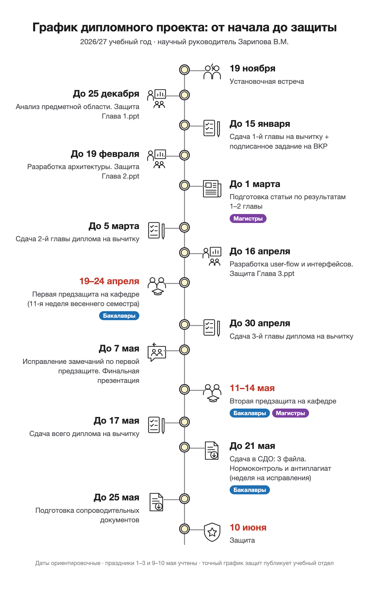

# План работ по диплому

> 📐 Этот гайд объясняет, *как* делать. Формальные требования (структура, объёмы, сроки, оформление) зависят от уровня — см. [requirements/](../requirements/README.md). При расхождении цифр правы требования.

> 📅 **Календарный график кафедры в СДО первичен.** Ниже — сроки руководителя на 2026/27; даты сдачи в СДО, предзащиты кафедры и защиты публикует кафедра, при расхождении правы они. Сроки и пороги — см. требования вашего уровня: [бакалавр](../requirements/bachelor-2026-27.md) / [магистр](../requirements/master.md).

*Иллюстрация рабочего ритма «презентация по главе → текст»; даты на схеме ориентировочные.*

**Материалы для отчётов по главам:**
- [Шаблон рабочей презентации](../templates/presentation/diploma-working-presentation-template.pptx)
- [Примеры отчётов по главам](../examples/presentations/README.md)

## Календарь бакалавра (кафедра ИП, 2026/27)

| Этап | Срок | Результат |
| --- | --- | --- |
| Установочная встреча | 19 ноября | Порядок работы, сроки, первое задание |
| Отчёт 1 — анализ предметной области (глава 1) | до 25 декабря | Рабочая презентация главы 1 |
| Текст главы 1 и задание на ВКР | до 15 января | Текст на вычитку; подписанное задание (сдаётся в зимнюю сессию) |
| Отчёт 2 — проектирование (глава 2) | до 19 февраля | Рабочая презентация главы 2 |
| Текст главы 2 | до 5 марта | Текст на вычитку |
| Отчёт 3 — реализация и тестирование (глава 3) | до 16 апреля | Рабочая презентация главы 3 |
| Первая предзащита | 19–24 апреля (11-я неделя весеннего семестра), онлайн | Обязательна; 3–5 минут по текущему состоянию работы, демо кода не требуется |
| Текст главы 3 | до 30 апреля | Текст на вычитку (до майских праздников) |
| Вторая предзащита | 11–14 мая | Итоговая презентация, замечания |
| Полный текст на вычитку | до 17 мая | Согласованный текст |
| Сдача в СДО, нормоконтроль, антиплагиат | до 21 мая (уточняется по графику кафедры) | Три файла в СДО; неделя на правки по нормоконтролю; «Руконтекст» ≥ 55 % |
| Сопроводительные документы | до 25 мая | Комплект для допуска |
| Проверка комплектности | за 3 дня (кафедра) и за 2 дня (секретарь ГЭК) до защиты | Полный комплект в СДО и на бумаге |
| Защита | ориентир 10 июня, по графику учебного отдела | Доклад до 5 минут + презентация + вопросы ГЭК |

Консультации с руководителем — не реже раза в неделю (ведётся журнал посещаемости). Статья по материалам работы — **по желанию**, для допуска не требуется (см. [245-scientific-paper.md](245-scientific-paper.md)).

## Календарь магистра (2026/27)

| Этап | Срок | Результат |
| --- | --- | --- |
| Установочная встреча | 19 ноября | Порядок работы, сроки, первое задание |
| Отчёт 1 — исследование (глава 1) | до 25 декабря | Рабочая презентация: актуальность, литобзор, аналоги, методы, своя методика |
| Текст главы 1 и задание на ВКР | до 15 января | Текст на вычитку; подписанное задание с этапами и сроками |
| Отчёт 2 — проектирование (глава 2) | до 19 февраля | Рабочая презентация: AS-IS / TO-BE, архитектура, структура данных |
| **Статья по материалам работы** | до 1 марта | Статья по главам 1–2 подана на публикацию (обязательна, п. 7.2 Положения; см. [245-scientific-paper.md](245-scientific-paper.md)) |
| Текст главы 2 | до 5 марта | Текст на вычитку |
| Изменение темы (если нужно) | не позднее чем за 3 месяца до ГИА | Приказ |
| Отчёт 3 — реализация (глава 3) и методика испытаний (глава 4) | до 16 апреля | Рабочая презентация глав 3–4 |
| Текст главы 3 | до 30 апреля | Текст на вычитку (до майских праздников) |
| Предзащита на кафедре | 11–14 мая | Итоговая презентация, замечания |
| Текст главы 4 — испытания | до 14 мая | Результаты испытаний, проверка гипотезы |
| Полный текст на вычитку | до 17 мая | Не менее чем за 12 рабочих дней до ГИА; отзыв руководителя — в течение 5 рабочих дней, направление на рецензию |
| Сдача в СДО, нормоконтроль, антиплагиат | до 21 мая (уточняется по графику кафедры) | Неделя на правки по нормоконтролю; отчёт о заимствованиях входит в комплект |
| Сопроводительные документы | до 25 мая | Отзыв, рецензия, подтверждение публикации |
| Комплект секретарю ГЭК | не позднее чем за 2 календарных дня до защиты | Бумажный оригинал, отзыв, рецензия, отчёт о заимствованиях |
| Защита | ориентир 10 июня, по графику ГИА | Доклад + презентация + вопросы, вся защита ≤ 30 минут |

Консультации и отчётность — по графику руководителя.

----

## Методика работы над дипломом

Работа строится вокруг поэтапной подготовки и защиты **презентаций по главам**, а затем — написания текста диплома по уже защищённым частям.

1. **Сначала — презентация, потом текст.**
   - Каждая крупная часть диплома (главы 1–3, у магистров также глава 4) сначала оформляется в виде рабочей презентации.
   - На онлайн-встрече студент защищает эту часть: рассказывает структуру главы, ключевые идеи, результаты, планы.

2. **Онлайн-защита части диплома.**
   - Консультационные встречи проходят по графику руководителя (запрос — в телеграм-группе); минимальная частота консультаций — по требованиям вашего уровня.
   - На встрече для защиты присутствуют все студенты, защита проходит в очередности установленной самими студентами. На выступление и обсуждение выделяется ограниченное время — укладывайтесь.
   - На защите студент показывает соответствующую часть презентации (Отчёт 1, 2 или 3).
   - По итогам защиты студент получает комментарии и доработки.

3. **После защиты презентации — текст главы.**
   - Студент дорабатывает материалы по комментариям. Повторно предъявлять презентацию к защите не требуется, доработки уйдут на финальную защиту так что честно их внести в ваших интересах.
   - На основе утверждённой презентации пишет текст соответствующей главы диплома.
   - Проверяет грамотность написанного текста.
   - Сдаёт текст на вычитку научному руководителю. В случае неграмотного текста вычитка останавливается и текст сдается обратно. Так что не теряйте зря время, тщательно вычитывайте перед сдачей. По результатам вычитки текст отправляется обратно на доработку.
   - После доработки текст сдаётся на вычитку снова.
   Комментарий: учтите что в конце весь текст диплома будет проверен на плагиат и фактическое наличие источников. ИИ можно использовать творчески переработав и проверив результаты.

4. **Параллельная работа.**
   - Пока идёт вычитка предыдущей главы, студент начинает готовить следующую часть презентации.
   - Таким образом, всегда есть «текущая» презентационная часть и «вычитываемая» текстовая часть.

5. **Предзащита.**
   - Бакалавр: обязательная онлайн-предзащита кафедры на 11-й неделе весеннего семестра (19–24 апреля) и вторая предзащита 11–14 мая (см. [bachelor-2026-27.md](../requirements/bachelor-2026-27.md)).
   - Магистр: предзащита на кафедре 11–14 мая, с презентацией рабочих результатов (см. [master.md](../requirements/master.md)).
   - После предзащиты студент вносит исправления в презентацию и текст.

6. **Финал.**
   - Полный текст диплома сдаётся на вычитку руководителю с запасом на правки — конкретные сроки сдачи см. в требованиях уровня и графике кафедры.
   - Затем готовится окончательная версия презентации (структура — в [250-presentation-defense.md](250-presentation-defense.md)).
   - Официальная защита — по графику ГИА.

Такой подход позволяет:
- не «залипать» в тексте сразу,
- регулярно фиксировать прогресс,
- рано выявлять концептуальные ошибки,
- тренировать выступление задолго до реальной защиты.